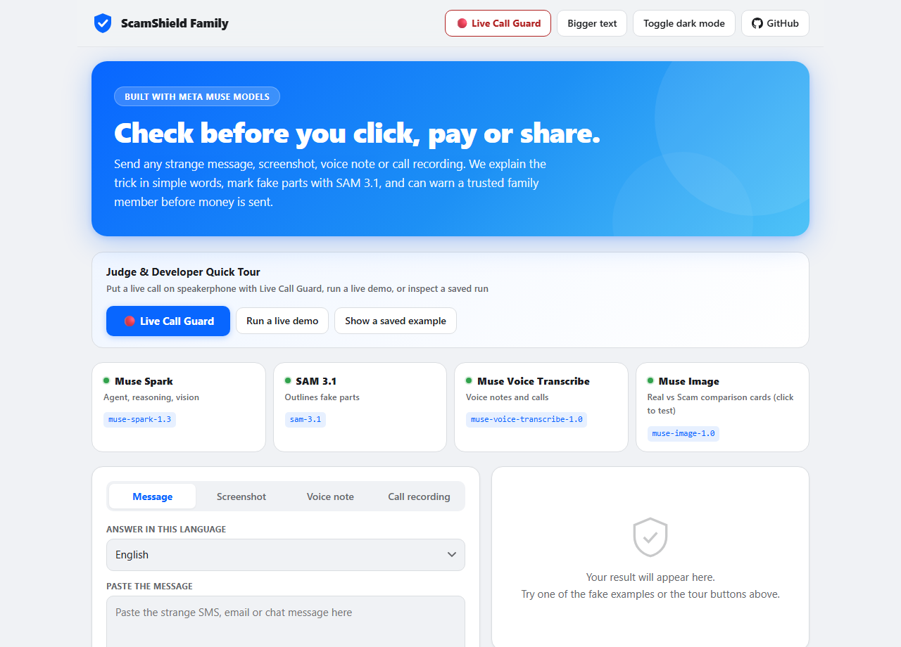
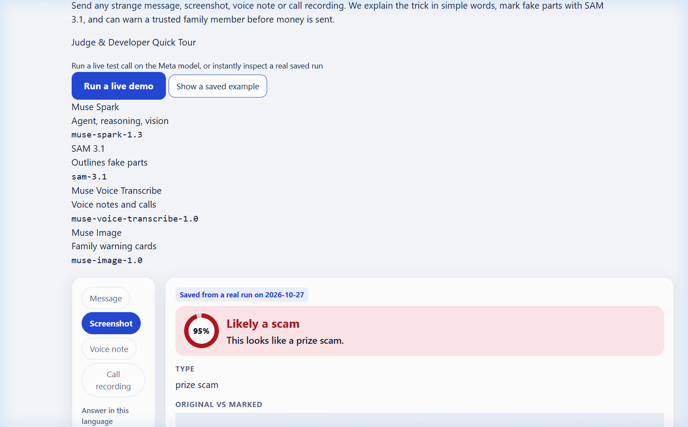
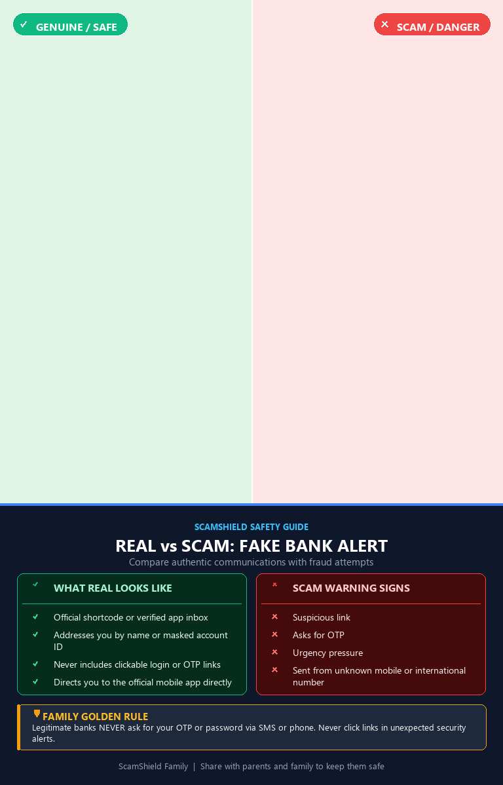
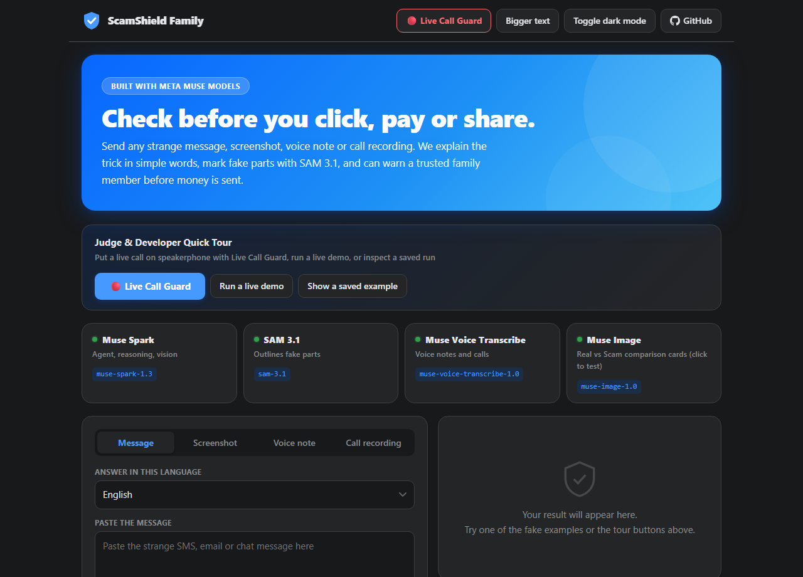
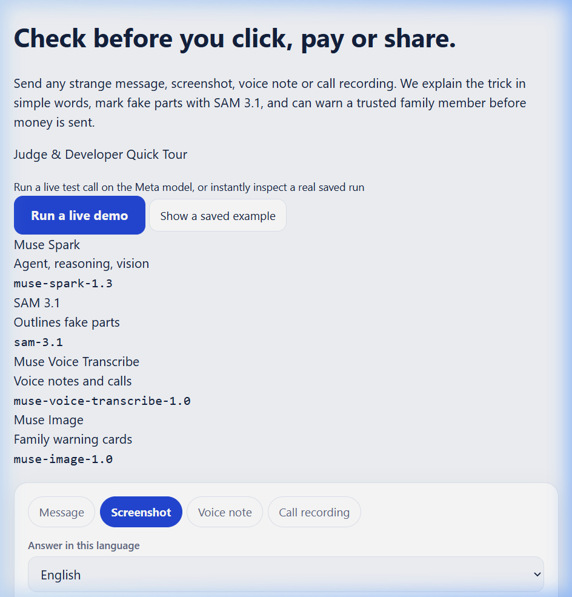
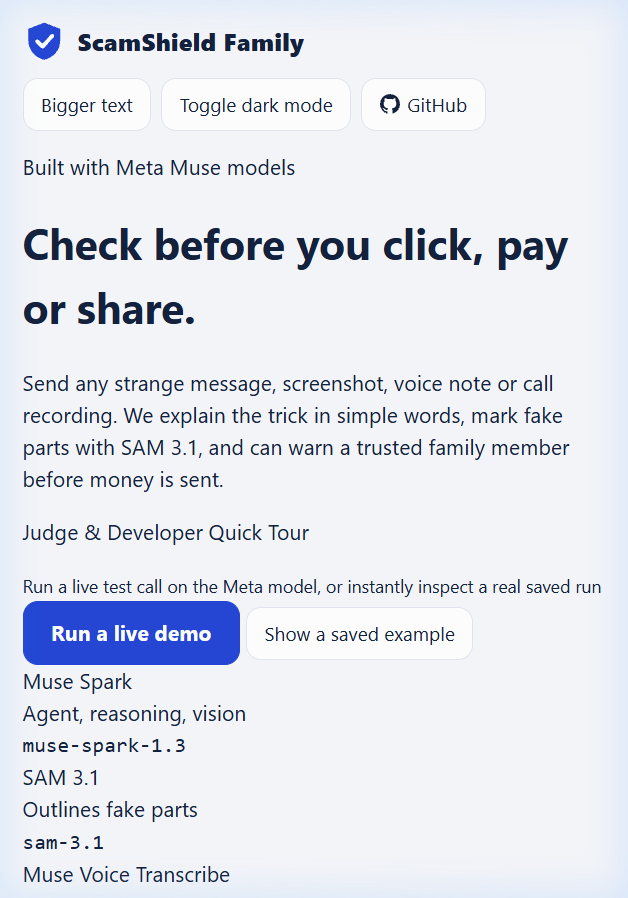

# ScamShield Family

An AI scam bodyguard prototype for families. Check a suspicious message,
screenshot, voice note, or recorded call; get a plain-language explanation,
suspicious screenshot boxes, and (when linked through Telegram) a guardian alert
for high-risk cases.

All code in this repo was written during the hackathon (Oct 26 – Nov 4, 2026).

## What it does

- **Live Call Guard (Headline Feature):** Put an incoming suspicious phone call on speakerphone. Audio streams over full-duplex WebSocket directly to Meta's **Muse Voice Transcribe Realtime** endpoint. Microsecond regex pressure checks and background Muse Spark cycles evaluate the conversation in real-time. If pressure tricks appear (asking for OTPs, money, gift cards, or secrecy), an unmistakable high-contrast alarm instructs the elder to **HANG UP IMMEDIATELY**, and an instant alert is dispatched to their family via Telegram.
- **Message Analysis:** Muse Spark returns schema-constrained scam analysis with grounded explanations.
- **Tool-Using Agent:** Checks links locally for lookalikes/shorteners, consults a scam playbook, and uses grounded web search with source links.
- **Screenshot Segmentation:** SAM 3.1 refines and segments suspicious interface elements (e.g. deceptive buttons or fake logos) with pixel-level bounding boxes.
- **Languages:** Text and screenshot answers can be requested in 74 languages (answer quality is not tested for each language). Voice notes and calls work in the 25 languages supported by Muse Voice Transcribe. Live-call banners are translated into 5 languages and need native-speaker review. The answer headings (Risk, Why, Red flags, What to do) and the safe fallback sentence are translated by Muse Spark for the chosen language, one small call per language, and have not been reviewed by native speakers.
- **Voice Notes & Audio Diarization:** Muse Voice Transcribe transcribes supported-language voice notes and diarizes calls. **Sinhala voice transcription is not supported.**
- **Family Guardian Alerts:** When linked via expiring Telegram invite codes, guardians receive real-time alerts. Model results do not replace checking official channels.

## Meta models and tools

| Model / tool | Use | Implementation |
|---|---|---|
| Muse Voice Transcribe Realtime (`wss://api.meta.ai/v1/asr/realtime`) | Full-duplex realtime speech recognition for Live Call Guard speakerphone monitoring | [app/guard.py](app/guard.py), [static/guard.html](static/guard.html) |
| Muse Spark (`muse-spark-1.3`) | Scam explanation, screenshot/call analysis, reasoning, tool-using agent, call guard evaluation | [app/llm.py](app/llm.py), [app/agent.py](app/agent.py), [app/guard.py](app/guard.py) |
| SAM 3.1 (`sam-3.1`) | Segment/refine suspicious screenshot boxes | [app/sam_refine.py](app/sam_refine.py) |
| Muse Voice Transcribe (`muse-voice-transcribe-1.0`) | Voice note transcription and call diarization | [app/voice.py](app/voice.py), [app/call.py](app/call.py) |
| Muse Image (`muse-image-1.0`) | Real-vs-Scam educational comparison card, made only when the user taps a button (web page and Telegram; `/api/comparison_card`). For an uploaded screenshot, Muse Image edits that screenshot into a genuine-looking version and the card shows it next to the original (`/api/screenshot_card`); the genuine version is AI-drawn with made-up details | [app/cards.py](app/cards.py) |
| `web_search` (Responses API) | Current web checks and source citations when useful | [app/agent.py](app/agent.py) |
| Local link checks & rules | Shorteners, lookalike domains, microsecond call pressure regex | [app/checks.py](app/checks.py), [app/guard_rules.py](app/guard_rules.py) |
| Telegram Bot API | Guardian link, alert delivery, quotas, status | [app/bot.py](app/bot.py), [app/notify.py](app/notify.py), [app/store.py](app/store.py) |


## Run locally

Requirements: Python 3.10+, ffmpeg on `PATH` for audio, and Meta Model API
credentials for model-backed features.

```powershell
python -m venv venv
venv\Scripts\activate
python -m pip install -r requirements.txt
Copy-Item .env.example .env
# Add MODEL_API_KEY to the local .env. Never commit that file.
python tests_offline.py
python tests_api_offline.py
python test_call.py
uvicorn app.main:app --reload
```

Open <http://127.0.0.1:8000>. To test on a private home Wi-Fi, run
`uvicorn app.main:app --host 0.0.0.0` and visit the host computer’s local IP
from the phone. Do not expose a development server directly to the internet.

Optional Telegram setup: add `TELEGRAM_BOT_TOKEN` and the public
`TELEGRAM_BOT_USERNAME` to `.env`, then run `python -m app.bot`. The public web
page only shows the family panel when a bot username is configured. 

## Synthetic evaluation

`data/test_set.csv` contains invented message examples, not real user messages.
Run `python evaluate.py` to make structured model calls and write
`data/eval_results.json`. Report the measured accuracy alongside coverage and
failed API cases; never treat synthetic accuracy as real-world accuracy.

For screenshot geometry, run:

```powershell
python tools\make_demo_screenshot.py
python test_sam.py data\demo_screenshot.png "red button"
python tools\evaluate_screenshots.py
```

`tools/stress_json.py` runs 20 live structured-output requests. This uses model
credits. `tools/compare_reasoning.py` compares default and low reasoning on a
small fixed synthetic sample. The optional Baseten comparison uses
`BASETEN_API_KEY` from the local `.env` and is a separate paid-provider run:
`python tools/compare_open_model.py`.

## Privacy and safety

- Submitted messages and media are not written to the application database.
- Voice/call uploads are written only to a temporary file and deleted when the
  request completes.
- Telegram SQLite stores family links, chosen languages, risk counts, and
  short-lived hourly-quota timestamps; it does not store message content.
- After a medium or high risk screenshot, the Telegram bot keeps that screenshot in memory only (not on disk, not logged) for up to 30 minutes, so the
  "Show me a genuine version" button can use it. It is dropped when used or expired.
- Telegram users are limited to 20 checks per hour, and web/bot media is limited
  to 32 MB. Browser screenshots are resized to at most 1600 px on their longest
  edge before upload.
- Keep `.env`, tokens, recordings, user content, local databases, and secrets out
  of Git. `.env` and SQLite files are ignored.
- The model is fallible. Verify payment requests, phone numbers, and account
  notices using contact details from an official card, app, or website.

## Honest limitations

- A model risk score is not a guarantee or a substitute for official
  verification.
- Web search can return irrelevant or weak sources; check sources yourself.
- SAM 3.1 may fail to identify or precisely box an object, especially from a
  vague prompt.
- Sinhala works for text and screenshot prompts but is not supported by Muse
  Voice Transcribe.
- Real Telegram alerts require a configured bot and consenting linked accounts.
  Automated tests do not prove delivery to your family members.
- A fake two-voice call smoke test does not prove broad diarization quality.
- The test set is small and synthetic; it does not measure live scam prevalence
  or general population accuracy.

## Results

| Evaluation | Result |
|---|---|
| Muse Spark text, development set (`data/test_set.csv`, the set prompts were tuned on) | Final: 105/105 correct (100% on this synthetic sample), 105/105 coverage, 0 false alarms, 0 missed scams, 0 worst mistakes. |
| Muse Spark text, unseen set (`data/heldout_set.csv`, `data/eval_heldout.json`) | 50/50 correct (100% on this synthetic sample), 0 false alarms, 0 missed scams. |
| First text-evaluation attempt | 66/66 of attempted cases correct; 66/105 coverage (62.9%) because of 39 transient API connection errors. |
| After retry handling | 105/105 correct and evaluated; same classifier/prompt, with transient connection retries. This improves coverage, not measured accuracy. |
| SAM 3.1 screenshot box test (`tools/evaluate_screenshots.py`, `data/eval_screenshots.json`) | SAM 3.1 alone, given the correct concept word: a SAM box overlapped the expected box (IoU ≥ 0.30) for 16 of 22 expected boxes on 22 procedurally generated scam screens; 0 false boxes on 3 safe screens. This does not score Muse Spark's own boxes or the full Muse Spark + SAM pipeline. |
| SAM 3.1 on the flat `data/demo_screenshot.png` | 0 boxes returned in 4 runs (see `evaluation scripts`). SAM marking works best on screens with clear buttons and logos; on plain text it may return nothing, and the app then shows Muse Spark's rough box. |
| Baseten Muse Spark Open | Not run because `BASETEN_API_KEY` is not configured; see `data/open_model_eval_results.json` if produced. |

These invented examples are intentionally clear and are not an independent,
blinded, or representative benchmark. Do not infer performance on real-world
messages, people, languages, or scam prevalence from this result.

On a separate 10-message synthetic reasoning comparison, the default Muse Spark
setting classified 10/10 correctly at 4.22 seconds mean request latency; `low`
reasoning classified 10/10 correctly at 2.99 seconds. The agent uses `low` by
default to reduce latency; this small sample does not establish a general
accuracy advantage.

## Performance & Latency (Telegram Bot vs. Web Demo)

To ensure rapid response times for elders on messaging platforms, the architecture uses dual execution modes:

- **Telegram Bot (Fast Mode, `BOT_FAST_MODE=1`)**: Optimized for low roundtrip latency. Local heuristic link checks run first (instant), findings are passed into exactly **one** `muse-spark-1.3` model call, and the family alert rule runs in deterministic code. Photos are resized/shrunk before upload, SAM 3.1 segmentation calls run in parallel via a thread pool, and text warnings are dispatched to guardians immediately before background card generation.
- **Web Demo (`/analyze/*`)**: Retains the full multi-turn tool-calling agent loop where `muse-spark-1.3` autonomously selects tools (`check_links`, `scam_playbook`, `alert_trusted_person`, `web_search`) and inspects tool results, allowing judges to observe the full agentic loop.

Measured on the real Meta API with `tools/time_pipeline.py`. These are two separate runs and are not mixed:

| Stage | Run 1 (SPEED_RESULTS table 1) | Run 2 (2026-10-28 re-measurement) |
|---|---|---|
| Single-call network floor (Sri Lanka to `api.meta.ai`) | 5.9s | 2.9s |
| Text, full agent loop | 48.3s | failed (API content filter on the test text) |
| Text, fast mode (1 model call) | 19.6s | 5.3s |
| Screenshot vision, original / shrunk | 45.7s / 17.1s | 14.9s / 10.8s |
| SAM 3.1, 4 concepts serial / parallel | 10.1s / 2.9s | 8.5s / 3.0s |

Latency varies a lot between runs, so treat these as examples from one machine, not guarantees.


## How this was built

I designed, directed, tested and verified this project myself during the hackathon (Oct 26 to Nov 4, 2026). I used AI coding assistants, Claude Code (Anthropic) and GitHub Copilot, to help write and review code. The numbers in this README come from scripts and result files in this repo (`evaluate.py`, `tools/`, `data/*.json`, `evaluation scripts`), and all test data and audio are synthetic.


## Screenshots

Captured from the running app with synthetic example content only.

### 1. Web Application & Scam Analysis
| Home (Desktop 1280px) | Scam Analysis Result & SAM 3.1 Segmentation |
| :---: | :---: |
|  |  |

### 2. Meta Muse Image (Real vs Scam Comparison Card) & Dark Mode
| Educational Comparison Card (muse-image-1.0) | Dark Mode Interface |
| :---: | :---: |
|  |  |

### 3. Responsive Design (Tablet & Mobile)
| Tablet View (768px) | Mobile Phone View (375px) |
| :---: | :---: |
|  |  |


## License

This project is licensed under the [MIT License](LICENSE).


