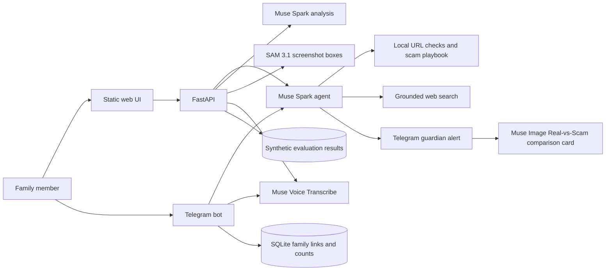

# Architecture

## Data flow and privacy

- Text is checked by the agent, local link checks, and web search when useful.
- Screenshots are analyzed by Muse Spark and optionally refined with SAM 3.1.
- Audio uploads are size-checked, converted to mono WAV with ffmpeg, transcribed,
  and deleted from temporary storage after the request finishes.
- Call recordings use Muse Voice Transcribe diarization and Muse Spark to identify
  pressure tactics. Speaker labels are session-only labels, not verified identities.
- Telegram SQLite stores family links, language preference, risk counts, and
  temporary rate-limit timestamps. It does not store message or audio content.
- The browser sends images no larger than 1600 px on their longest edge.
- API keys stay in the local environment and are not returned by `/api/config`.
- `data/eval_results.json` contains aggregate results and examples from the
  synthetic evaluation dataset, not user submissions.

## Dual execution modes

- **Telegram Bot (Fast Path)**: High-speed path (`BOT_FAST_MODE=1`). Deterministic URL checks execute instantly in code, followed by exactly one `muse-spark-1.3` call. The high-risk family alert decision is evaluated in code, sending an immediate text warning to guardians. The elder then receives a Real-vs-Scam educational comparison card (Muse Image) asynchronously. Screenshots are shrunk to 1024px and SAM 3.1 segmentation runs across all concepts concurrently.
- **Web Demo (Full Agent)**: Autonomous tool-calling agent loop (`run_agent`). The model autonomously calls `check_links`, `scam_playbook`, `alert_trusted_person`, and `web_search`, exposing the full agent reasoning and trace to judges.

